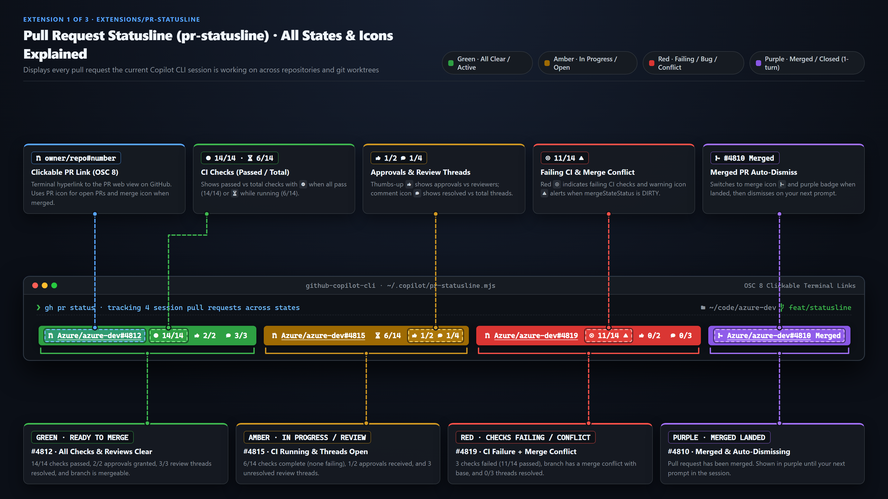
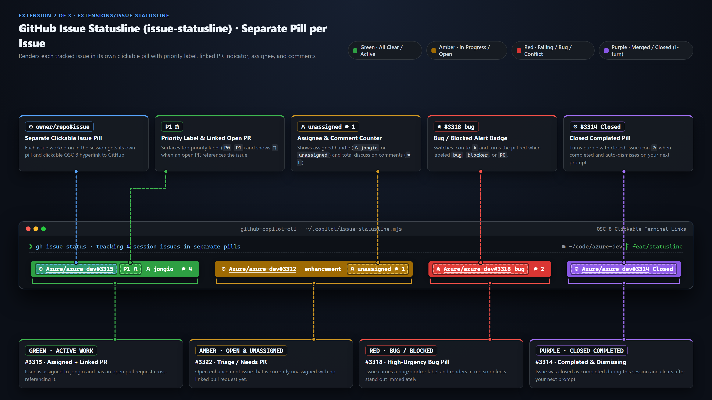
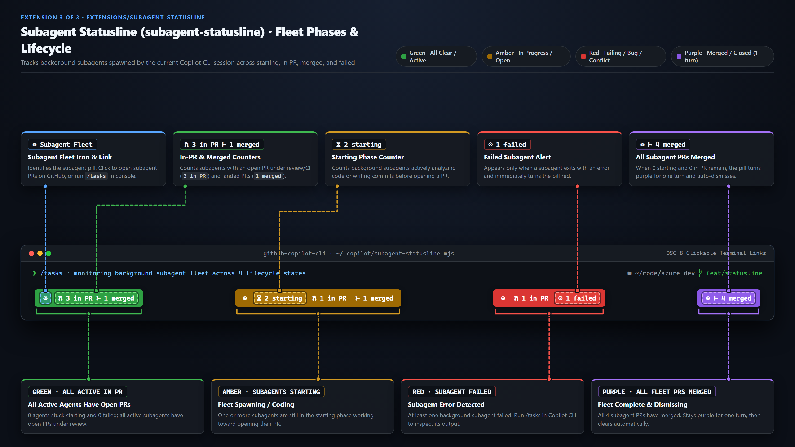

# copilot-extensions

Jon's collection of **GitHub Copilot extensions** — they work in both the **GitHub Copilot
app** and the **Copilot CLI**, which load extensions from the same place. Most are **canvas
extensions** (interactive side-panel apps, app-only since the CLI has no panel), but the
collection isn't limited to canvases: an extension can also just contribute agent tools or
hooks with no UI at all, and those run anywhere Copilot does.

## Install one

You install extensions from inside Copilot — in the app or the CLI, just ask the agent:

> **install the stock-ticker canvas from jongio/copilot-extensions/extensions/stock-ticker**

Copilot fetches the folder into `~/.copilot/extensions/`, reloads, and it's ready. For a
canvas, then (in the app):

> **open stock ticker**

For the composable CLI statusline extensions ([`pr-statusline`](extensions/pr-statusline), [`issue-statusline`](extensions/issue-statusline), and [`subagent-statusline`](extensions/subagent-statusline)), run the interactive setup command for your OS. It prompts you for whether you want **Pull Requests**, **GitHub Issues**, and/or **Subagents**, and automatically configures `~/.copilot/statusline-compose.mjs` and `~/.copilot/settings.json`:

**Windows (PowerShell):**

```powershell
# One-liner (no clone required)
irm https://raw.githubusercontent.com/jongio/copilot-extensions/main/install-statusline.ps1 | iex

# Or from a local clone
.\install-statusline.ps1
```

**macOS & Linux (Bash / Zsh):**

```bash
# One-liner (no clone required)
curl -fsSL https://raw.githubusercontent.com/jongio/copilot-extensions/main/install-statusline.sh | bash

# Or from a local clone
./install-statusline.sh
```

**Cross-platform (Node.js or Copilot CLI prompt):**

```bash
node ./scripts/setup-statusline.mjs
```

> **set up the copilot statusline from jongio/copilot-extensions and ask me whether I want PRs, issues, and/or subagents**

## Extensions

| Extension | Type | What it is |
| --- | --- | --- |
| [`pr-statusline`](extensions/pr-statusline) | CLI statusline | Live, color-coded PR status pills in the Copilot CLI footer for every PR **this session** is working on (across repos and worktrees): clickable PR links, CI check progress (`// passed/total`), approvals (` approved/total`), resolved review comments (` resolved/total`), and a purple ` Merged` badge that dismisses on your next input. Auto-hides when no PRs are active. |
| [`issue-statusline`](extensions/issue-statusline) | CLI statusline | Live, color-coded GitHub issue pills in the Copilot CLI footer for issues **this session** is working on: clickable issue links, priority/bug labels, linked PR numbers, assignees, comment counts, and a purple ` Closed` badge that dismisses on your next input. Composes side-by-side with `pr-statusline` and `subagent-statusline`. |
| [`subagent-statusline`](extensions/subagent-statusline) | CLI statusline | Live subagent state counter pill (`  N starting  N in PR  N merged`) for the active session, turns purple when all subagent PRs merge, and dismisses on your next input. Composes side-by-side with `pr-statusline` and `issue-statusline`. |
| [`news-aggregator`](extensions/news-aggregator) | Canvas | Pick a topic or free-text search and get a live, shared news feed (Google News, no API key). Save/favorite/hide items, search history, pin searches as custom topics with auto-picked icons, sort & filter, visible-only auto-refresh — plus a one-tap **AI TL;DR digest** of the current headlines. |
| [`stock-ticker`](extensions/stock-ticker) | Canvas | A personalized live stock watchlist — shared between you and the agent, with live quotes, sparklines, and an **AI market summary** of what's moving. |
| [`random-animal`](extensions/random-animal) | Canvas | Roll the dice to discover a random animal and a fun fact — with bounce-in animations, floating emojis, roll history, and a **"Tell me more" AI fun fact**. |
| [`language-tutor`](extensions/language-tutor) | Canvas | Pick a language and a gamified course appears — flashcards, quizzes, XP, levels, streaks, hearts, gems, mascots and confetti, plus **AI example sentences** for any word. You and the agent share one learner profile. |
| [`wiki-discover`](extensions/wiki-discover) | Canvas | A "for you" Wikipedia reader shared with the agent — pick interests (or thumbs up / meh / not-for-me each article) and it learns your topics and surfaces popular articles you'll find interesting, with article images, a live preference profile, and an **AI TL;DR** per article. |
| [`code-tutor`](extensions/code-tutor) | Canvas | Turns the current codebase into a personal CS course: extracts the algorithms, data structures, complexity and theory in your code, explains each at an adjustable level (ELI5 to Wizard), points at real files with syntax-highlighted code, tracks what you understand, answers questions, and reviews good/ok/bad spots with a path to fix them. |

Every canvas above is built on **canvas-kit `2026-06-27.1`**, which gives a canvas action handler a host-model bridge: `ctx.ai(question)` for a silent, no-tools answer that never adds a turn to the chat, and `ctx.askAgent(prompt)` to hand a tool-capable turn to the main agent. The **AI** features called out above all use `ctx.ai` — `extension.mjs` wires it via `runtime.setHost(...)`, and the action stays SDK-free (it just marks state "thinking" and writes the answer back), so the smoke tests still run with no SDK or network.

The CLI statusline extensions use a shared `statusLine.command` compositor (`statusline-compose.mjs`) that incrementally reads the active session's transcript and renders each extension's clickable pills side-by-side:

- **PR Statusline (`pr-statusline`):** ` Azure/azure-dev#4812  14/14  2/2  3/3` · ` Azure/azure-dev#4810 Merged`
- **Issue Statusline (`issue-statusline`):** ` Azure/azure-dev#3315 P1   jongio  4` · ` Azure/azure-dev#3318 bug  2`
- **Subagent Statusline (`subagent-statusline`):** `  1 starting  1 in PR  1 merged`


### Statuslines in isolation

**1. PR Statusline (`extensions/pr-statusline`):**



**2. Issue Statusline (`extensions/issue-statusline`):**



**3. Subagent Statusline (`extensions/subagent-statusline`):**



Each lives in its own folder under [`extensions/`](extensions) and is fully self-contained
(its `extension.mjs` plus whatever it needs — for a canvas that's `canvas-kit/` + `web/` +
`copilot-extension.json`), so any one installs on its own.

## Scope

Ask for **user** scope (default — `~/.copilot/extensions/<name>/`, just for you) or **project**
scope (`./.github/extensions/<name>/`, committed and shared with a repo's team). If you don't
say, Copilot installs to user scope.

## Building your own

Canvas extensions are built with [`create-canvas-app`](https://github.com/jongio/skills/tree/main/skills/create-canvas-app) —
a Copilot skill (in [`jongio/skills`](https://github.com/jongio/skills)) that scaffolds a canvas
(Preact + htm, Octicons, no build step). To add one here: generate it with the kit, drop the folder
under `extensions/`, add a row to the table above, and it's installable the same way. See the kit's
[**Ship it**](https://github.com/jongio/skills/blob/main/skills/create-canvas-app/README.md#ship-it)
section for the round trip.

Non-canvas extensions are just an `extension.mjs` that contributes tools or hooks — drop the
folder under `extensions/` and add a row with its type.

## Repository layout

```
copilot-extensions/
├─ extensions/                 # the extensions, one self-contained folder each
│  ├─ pr-statusline/           # CLI statusline: session PR pills + shared compositor
│  ├─ issue-statusline/        # CLI statusline: session GitHub issue pills
│  ├─ subagent-statusline/     # CLI statusline: session subagent state counts
│  ├─ news-aggregator/         # …each with a test/smoke.test.mjs
│  ├─ stock-ticker/
│  ├─ random-animal/
│  ├─ language-tutor/
│  ├─ wiki-discover/
│  └─ code-tutor/
├─ install-statusline.ps1      # interactive statusline installer for Windows (local or irm | iex)
├─ install-statusline.sh       # interactive statusline installer for macOS & Linux (local or curl | bash)
├─ scripts/
│  ├─ setup-statusline.mjs     # interactive configurator (prompts for PRs, Issues, Subagents)
│  ├─ lint.mjs                 # dependency-free syntax + JSON check (run in CI)
│  ├─ validate-extensions.mjs  # structure check (run in CI)
│  └─ run-tests.mjs            # runs every extension's smoke test (run in CI)
└─ .github/
   ├─ dependabot.yml           # keeps the SHA-pinned Actions current
   └─ workflows/
      └─ validate.yml          # lint + validate + tests, and lints the workflows
```

Validate locally with `node scripts/lint.mjs` (syntax-checks every `.mjs` and parses
every `.json`) and `node scripts/validate-extensions.mjs` (structure check), and run
the smoke tests with `node scripts/run-tests.mjs` (each boots its canvas's kit runtime
over loopback HTTP — no SDK, no network). CI runs the lint, the structure check, and
the smoke tests on every push and pull request, and lints the workflow files themselves.

## License

MIT © Jon Gallant
